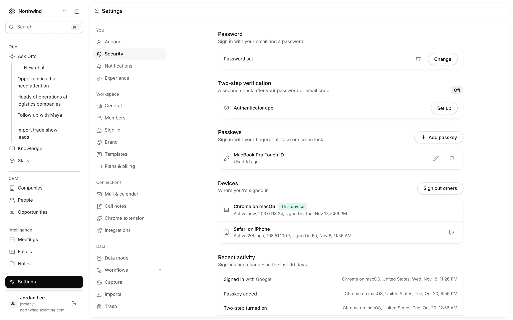

import { Aside, CardGrid, LinkCard, Steps } from '@astrojs/starlight/components';

**Settings**, then **Security** is where you protect your own account. Nobody else, not even an admin, can change these for you.

**Address:** `/settings/security` **Who:** everyone, for their own account

## Password

"Sign in with your email and a password."

| Control | What it does |
| --- | --- |
| Set or change a password | Type a new password. Omniscient may first ask you to "Type the code we emailed you" to confirm it's you. Then it says "Password saved". |
| **Remove password** | Asks "Remove your password?" You then sign in with an email code, Google, Microsoft, Apple or a passkey. |

Passwords need at least 10 characters. A password that showed up in a known data leak is refused.

## Two-step verification

"A second check after your password or email code."

The section shows **Off** until you turn on a method. You can use more than one.

| Method | How it works |
| --- | --- |
| **Authenticator app** | Scan the QR code with an app like 1Password, Google Authenticator or Authy, then type the code it shows. **Turn off** removes it. |
| **Text message** | Type your phone with its country code, like +1 415 555 0100, then the **Code we texted you**. Only where your server offers text codes. |
| **Backup codes** | Ten one-time codes for when you don't have your phone. Shown once as **Your backup codes**, with **Copy codes** and **Download codes**. Make new ones any time. The old ones stop working. |

When you turn off a method, Omniscient asks "Stop using *authenticator app*?" first.

## Passkeys

"Sign in with your fingerprint, face or screen lock."

| Control | What it does |
| --- | --- |
| Add a passkey | Your device asks for your fingerprint, face or screen lock. Name it in the **Passkey name** box. Omniscient says "*MacBook* added". |
| **Rename** | Change its name |
| **Delete** | Asks "Delete *MacBook*?" and removes it |

A passkey also counts as two-step on its own. With a passkey, the sign-in screen can fill your account from the email box's autofill.

## Devices

"Where you're signed in."

Each row shows a browser and when it was last used. **This device** marks the one you're on.

| Control | What it does |
| --- | --- |
| **Sign out** on a row | Asks "Sign out *Chrome on Mac*?" and ends that session |
| Sign out every other device | Asks "Sign out every other device?" Omniscient says how many it signed out. |

## Recent activity

"Sign-ins and changes in the last 90 days."

A list of sign-ins, new devices, password changes and two-step changes on your account. If you see something you didn't do, change your password and sign out every other device.

<Aside type="tip">
Omniscient also emails you when something big changes, like a new sign-in method or a password change.
</Aside>

## Related

<CardGrid>
  <LinkCard title="Sign-in rules" href="/settings/sign-in/" description="What your workspace asks of everyone." />
  <LinkCard title="Account" href="/settings/account/" description="Your profile and sign-in methods." />
</CardGrid>
