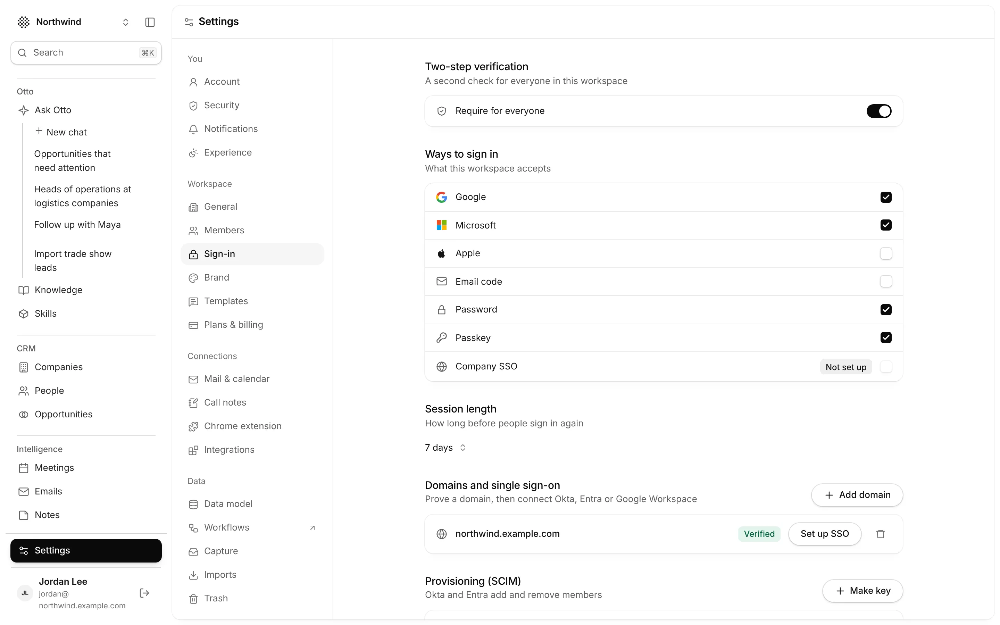
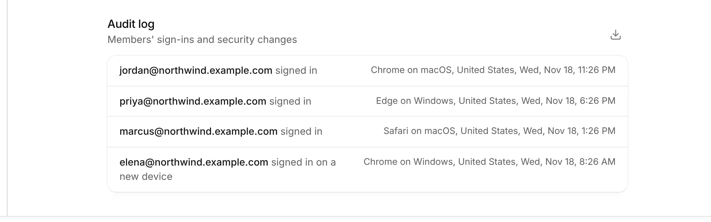

import { Aside, CardGrid, LinkCard, Steps } from '@astrojs/starlight/components';

**Settings**, then **Sign-in** sets the rules everyone in the workspace signs in by. For the step-by-step setup of SSO, see [Sign-in rules and SSO](/workspace/sign-in-rules-and-sso/).

**Address:** `/settings/signin` **Who:** owners and admins only. Members don't see this page.

**Plan:** these are admin controls, on Business. On a lower plan, or during the Pro trial, the page shows "Admin controls come with Business" with **Upgrade**, and **Invite links** below it. If sign-in rules are already on, a **Turn off** button sets them back to the defaults: no two-step for everyone, every way in, no session limit and no "only SSO" domain. Rules you set before keep working until you turn them off.

## Two-step verification

"A second check for everyone in this workspace."

| Setting | Default | What it does |
| --- | --- | --- |
| **Require for everyone** | Off | Everyone must set up two-step before they can open the workspace. They see "Your workspace asks everyone to use an authenticator app." |

You must use two-step yourself before you can turn this on, so you can't lock yourself out.

## Ways to sign in

"What this workspace accepts."

Tick the ways people may sign in: **Google**, **Microsoft**, **Apple**, **Email code**, **Password**, **Passkey** and **Company SSO**. All are on by default, except **Company SSO**, which shows **Not set up** until you connect it. You must keep at least one: "Keep at least one way in."

## Session length

"How long before people sign in again."

| Choice | |
| --- | --- |
| **No limit** | The default. People stay signed in until they sign out. |
| **8 hours**, **1 day**, **7 days**, **30 days** | People sign in again after this long |

## Domains and single sign-on

"Prove a domain, then connect Okta, Entra or Google Workspace."

<Steps>

1. Add your company's domain. Omniscient shows a **TXT name** and a **TXT value** with copy buttons.
1. Add that TXT record in your domain's DNS settings, then verify. Omniscient says "*domain* is verified" and the row shows **Verified**.
1. Click **Connect** for SSO. Copy the details into your identity provider as a SAML app: "Add Omniscient as a SAML app in your identity provider with these."
1. Paste the **Metadata URL from your identity provider**, like `https://acme.okta.com/app/…/sso/saml/metadata`. Omniscient says "Single sign-on is on for *domain*", and the row shows **SSO**.

</Steps>

| Control | What it does |
| --- | --- |
| **Remove domain** | Asks "Remove *domain*?" A domain with SSO on must have SSO turned off first. |
| Turn off SSO | Asks "Turn off single sign-on for *domain*?" |
| **Only SSO for *domain*** | A switch that makes SSO the only way in for people at that domain. It needs working SSO first: "Set up single sign-on before making it the only way in". |

A verified domain belongs to one workspace. Free mail domains like gmail.com can't be verified.

## Provisioning (SCIM)

"Okta and Entra add and remove members."

Make a SCIM key, named in the **Name this key** box. Copy the **Base URL** and the key into Okta or Entra. The key is shown once: "It won't show again." **Revoke** stops a key. People your identity provider removes leave the workspace like a removal in **Members**.

## Invite links

"Anyone with the link joins until it expires."

Pick the **Role** (**Member** or **Admin**) and when it **Expires**, then make the link and copy it. **Turn off** asks "Turn off this invite link?" and the link stops working.

## Audit log

"Members' sign-ins and security changes."

A list of sign-ins, new devices, two-step changes and setting changes by everyone in the workspace. Click **Download CSV** to save it.

## Related

<CardGrid>
  <LinkCard title="Sign-in rules and SSO" href="/workspace/sign-in-rules-and-sso/" description="The how-to guide." />
  <LinkCard title="Security" href="/settings/security/" description="Your own two-step and passkeys." />
</CardGrid>
