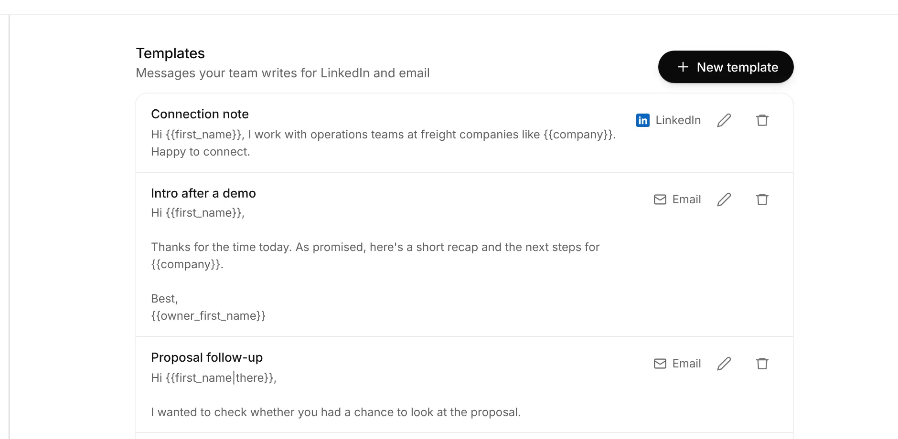

import { Aside, CardGrid, LinkCard, Steps } from '@astrojs/starlight/components';

**Settings**, then **Templates** holds "Messages your team writes for LinkedIn and email." Your team writes every template. Omniscient has no ready-made templates, and Otto never writes or changes one.

**Address:** `/settings/templates` **Who:** everyone in the workspace can add, edit and delete templates

## Add a template

On a workspace with no templates, the page shows **Add your first template**.

<Steps>

1. Click the add button.
1. Type a **Name** your team will know, like "First note after a call".
1. Pick a **Channel**: **Any**, **LinkedIn** or **Email**.
1. For email, type a **Subject**.
1. Write the **Message**. Click a variable to put it where your cursor is.
1. Save.

</Steps>

## Variables

Variables are filled in from the person's record when you use the template.

| Variable | Fills in |
| --- | --- |
| `{{first_name}}` | Their first name |
| `{{last_name}}` | Their last name |
| `{{full_name}}` | Their full name |
| `{{company}}` | Their company |
| `{{title}}` | Their job title |
| `{{my_first_name}}` | Your first name |
| `{{my_company}}` | Your company |

- Spaces inside the braces and letter case don't matter: `{{ First_Name }}` works.
- A variable with no value stays as written, like `{{title}}`, so you see it and fill it in before you send.
- A variable that isn't on the list shows a line under the message, like "Unknown: `{{nickname}}`".

## Use a template

| Where | How |
| --- | --- |
| LinkedIn, in Chrome | Open a message box with the Omniscient extension installed. Pick a template. It goes into the box for you to read, change and send yourself. |
| Gmail, in Chrome | The same, in a Gmail compose window |
| The extension's side panel | Pick a template on the person's record |

Omniscient never sends a LinkedIn message for you. You always press send.

## Edit or delete

Each row has **Edit** and **Delete**. **Delete** asks "Delete *name*?" first.

<Aside type="tip">
Keep a few short templates your team actually uses. A note after a call and a reply to a form are good first ones.
</Aside>

## Related

<CardGrid>
  <LinkCard title="Use the extension" href="/chrome-extension/use-the-extension/" description="Put a template into LinkedIn or Gmail." />
  <LinkCard title="Chrome extension settings" href="/settings/chrome-extension/" description="Install and connect it." />
</CardGrid>
