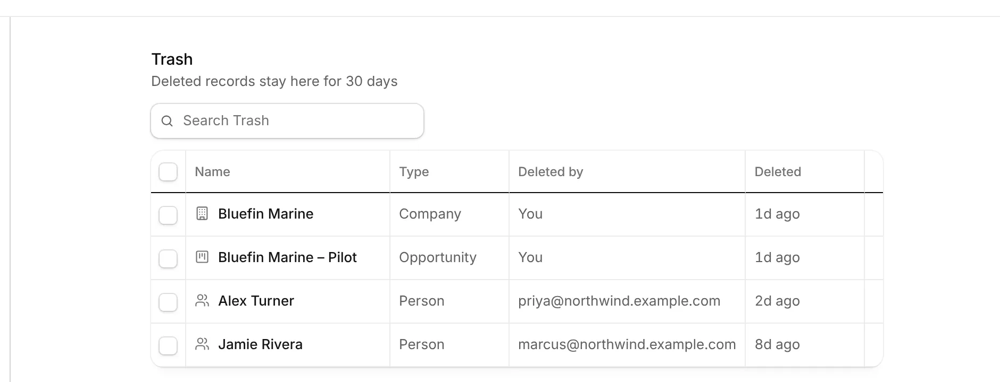

import { Aside, CardGrid, LinkCard } from '@astrojs/starlight/components';

**Settings**, then **Trash** keeps what you delete: "Deleted records stay here for 30 days."

**Address:** `/settings/trash` **Who:** everyone. Anyone can restore. Owners, admins and the person who deleted a record can delete it forever.

## What goes to Trash

Deleting a company, person, opportunity or custom record moves it here, with everything that went with it: a company's opportunities, notes, links, files and field values. While it's in Trash, it doesn't show in lists, search, Otto, the API or the MCP server.

Right after you delete, a line with **Undo** shows for 10 seconds. After that, use Trash.

## The list

| Column | What it shows |
| --- | --- |
| **Name** | The record's name |
| **Type** | Company, person, opportunity or the custom object's name |
| **Deleted by** | Who deleted it |
| **Deleted** | When, and how many days are left |
| **Actions** | **Restore** and **Delete forever** |

Type in **Search Trash** to find a record. With nothing deleted, the page says **Trash is empty**.

## Restore

Click **Restore** on a row, or tick several and click **Restore** in the bar. The record comes back as it was, with what was deleted with it. Edits made to other records since then are kept.

| Line | What it means |
| --- | --- |
| Restored | It's back |
| Not restored: another record already has the same domain, email or unique field | A newer record took its place. Merge or change the newer one, then restore. |
| *2 records* weren't restored | Something else went wrong. Click **Retry**. |

## Delete forever

Click **Delete forever** on a row, or tick several. Omniscient asks "Delete *name* forever?" and warns "This can't be undone."

After 30 days in Trash, records are deleted forever on their own. Files go with them.

## Select many

Tick **Select all**, or tick rows one by one. The bar shows **Restore**, **Delete forever** and **Clear selection**. Up to 1,000 at a time.

<Aside type="note">
Notes, files and templates you delete on their own don't go to Trash. They ask before they go.
</Aside>

## Related

<CardGrid>
  <LinkCard title="Data and trash" href="/workspace/data-and-trash/" description="Exports, deletes and keeping data safe." />
  <LinkCard title="Companies and people" href="/crm/companies-and-people/" description="Delete and merge records." />
</CardGrid>
