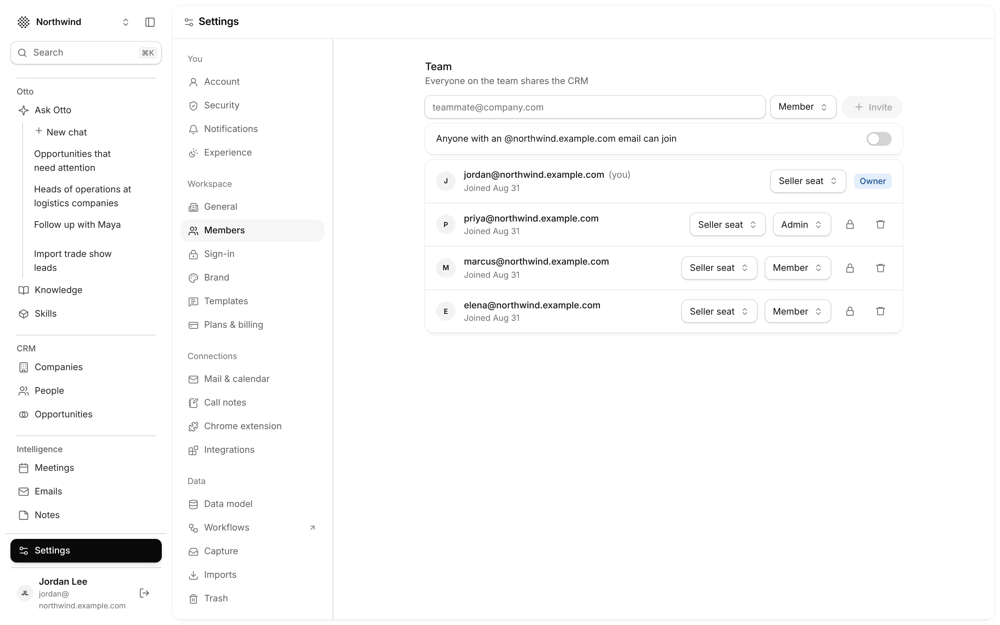

import { Aside, CardGrid, LinkCard } from '@astrojs/starlight/components';

Everyone in a workspace shares the CRM. Each person has one role, and on Pro and Business each person also has a seat type. Manage both in **Settings**, then **Members**.

## Roles

| Role | Who it's for |
| --- | --- |
| Owner | The person who made the workspace, or the person they handed it to. There is one owner. |
| Admin | People who set up and run the workspace |
| Member | Everyone else on the team |

### What each role can do

| Task | Owner | Admin | Member |
| --- | --- | --- | --- |
| Use the CRM, Otto, workflows and the Chrome extension | Yes | Yes | Yes |
| Connect their own mailbox, Zoom and personal apps | Yes | Yes | Yes |
| Make Personal skills and Knowledge | Yes | Yes | Yes |
| Make and edit Workspace skills | Yes | Yes | No |
| Invite people and change roles | Yes | Yes | No |
| Change the data model | Yes | Yes | No |
| Connect team apps like Slack or HubSpot | Yes | Yes | No |
| Run imports from another CRM | Yes | Yes | No |
| Set up Capture, Brand and Sign-in rules | Yes | Yes | No |
| Choose a plan and manage billing | Yes | Yes | No |
| Delete anything in the Trash | Yes | Yes | Their own items |
| Make someone else the owner | Yes | No | No |
| Delete the workspace | Yes | No | No |

## Seats

On Pro and Business, each person has a **Seller seat** or a **Free seat**.

- **Seller seat**: the full plan, for people who sell.
- **Free seat**: for teammates who only view records or log their own email and meetings. Free seats cost nothing.

Admins pick a person's seat in the menu next to their name. See [Plans and billing](/workspace/plans-and-billing/).

## Change a role

Pick **Member** or **Admin** in the menu next to the person's name. The owner's role can't be changed here.

## Hand the workspace to a new owner

The owner clicks **Make owner** (the crown) next to a teammate who has joined, then confirms. That person becomes the owner, and the old owner becomes an admin. See [Members settings](/settings/members/#make-someone-else-the-owner).

## Sign someone out

Click **Sign out everywhere** next to a person to end all their sessions. They stay on the team and can sign in again.

## Remove someone

Click **Remove from workspace** next to the person and confirm. Their mailboxes are disconnected and the emails they brought in are deleted. The companies, people, notes and opportunities they worked on stay with the team.

To leave a workspace yourself, click **Leave workspace** next to your own name. Your mailboxes in that workspace are disconnected.

## Pending invites

Invites that haven't been used yet show with **Invite sent**. Click **Send again** to resend, or **Withdraw invite** to cancel. See [Invite your team](/get-started/invite-your-team/).

## Next steps

<CardGrid>
  <LinkCard title="Roles and permissions" href="/workspace/roles-and-permissions/" description="The full grid of who can do what." />
  <LinkCard title="Sign-in rules and SSO" href="/workspace/sign-in-rules-and-sso/" description="Require two-step, limit sign-in methods and connect SSO." />
  <LinkCard title="Plans and billing" href="/workspace/plans-and-billing/" description="Prices, seats and the free trial." />
</CardGrid>
