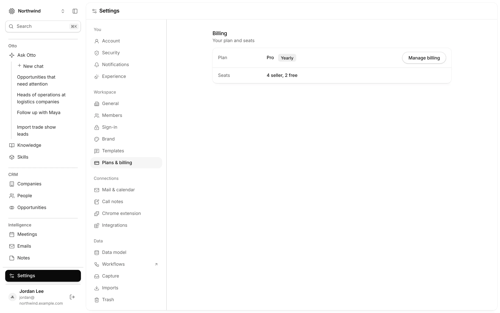

import { Aside, CardGrid, LinkCard, Steps } from '@astrojs/starlight/components';

Omniscient is priced per seat, and Otto is included in every paid seat. A busy month never adds a usage bill. New workspaces start with a 14-day free trial of Pro, with no card needed.

## Plans

| | Free | Starter | Pro | Business |
| --- | --- | --- | --- | --- |
| Per seat a month, billed yearly | $0 | $19 | $49 | $99 |
| Per seat a month, billed monthly | $0 | $23 | $59 | $119 |
| Meeting notes and drafts | — | Yes | Yes | Yes |
| Pipeline board and forecast | — | — | Yes | Yes |
| Fields filled by rules | — | — | Yes | Yes |
| Prep briefs and field packs | — | — | Yes | Yes |
| Free teammate seats | — | — | Yes | Yes |
| Manager mode and coaching | — | — | — | Yes |
| MEDDIC from every call | — | — | — | Yes |
| Admin controls | — | — | — | Yes |
| Agents | 0 | 2 | 5 | 15 |

These are the lines on each plan card in **Plans & billing**. For every limit the app checks, like the Kanban board on Pro, see [Plan limits](/workspace/plan-limits/).

Monthly billing costs about 20% more than yearly billing. For every feature in each plan, see the [pricing page](https://tryomniscient.com/pricing).

### Team discounts

| Seats | Discount |
| --- | --- |
| 21 to 50 | 10% off (check) |
| 51 to 100 | 20% off (check) |
| More than 100 | [Talk to us](mailto:hello@tryomniscient.com) |

## The free trial

Every new workspace gets 14 days of Pro for free. You don't need a card. **Plans & billing** shows a **Trial** tag with the days left.

When the trial ends without a plan, the workspace moves to Free. Your data stays safe, and you can pick a plan at any time to get the paid features back.

## Seller seats and Free seats

On Pro and Business, each person has a **Seller seat** or a **Free seat**:

- **Seller seats** are billed at your plan's price.
- **Free seats** are for teammates who only view records or log their own email and meetings. They cost nothing.

Admins set each person's seat in **Settings**, then **Members**. **Plans & billing** shows how many of each you have.

## Choose a plan

Owners and admins manage billing.

<Steps>

1. Go to **Settings**, then **Plans & billing**.
1. Under **Choose a plan**, pick **Yearly** or **Monthly**.
1. Each plan card shows the price per seat and your total for your current number of seats.
1. Click **Choose Starter**, **Choose Pro** or **Choose Business** and pay with a card on the secure checkout page.

</Steps>

Back in Omniscient, you see "Plan updated. It can take a minute to show here."

## Change plans, update your card or cancel

Once you have a plan, click **Manage billing** in **Plans & billing**. Stripe's billing portal opens. There you can change your plan, update your card or cancel.

### Billing status

| Tag | What it means | What to do |
| --- | --- | --- |
| Payment failed | The last charge didn't go through | Click **Manage billing** and update your card |
| Payment pending | A payment is still being confirmed | Wait a few minutes and check again |
| Paused | Billing is on hold | Click **Manage billing** to see why |

<Aside type="note">
To delete your account while a workspace you own alone is on a paid plan, cancel the plan first. See [Account and security](/workspace/account-and-security/#delete-your-account).
</Aside>

## Next steps

<CardGrid>
  <LinkCard title="Members and roles" href="/workspace/members-and-roles/" description="Set roles and seats for your team." />
  <LinkCard title="Plan limits" href="/workspace/plan-limits/" description="Every limit, seat and credit." />
  <LinkCard title="FAQ" href="/reference/faq/#plans-and-billing" description="Common billing questions." />
</CardGrid>
